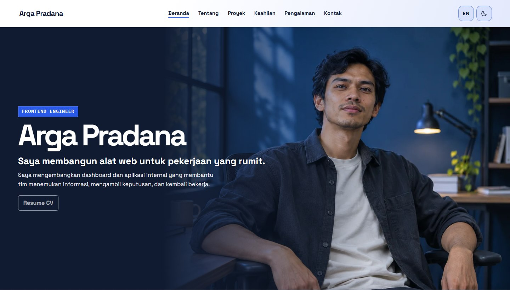

# TAP.ID Portfolio Templates

Enam template portofolio untuk paket **NFC + Linktree + Website Portofolio** TAP.ID. Setiap tema punya desain tersendiri, tampilan responsif, Bahasa Indonesia dan English, serta mode terang dan gelap.

[Pilih tema](#pilih-tema) · [Jalankan lokal](#jalankan-lokal) · [Siapkan situs pelanggan](#siapkan-situs-pelanggan) · [Galeri desain](#galeri-desain)



## Pilih tema

| Tema | Warna bawaan | Panduan |
| --- | --- | --- |
| [1 · Teknologi](Portfolio%201%20-%20Teknologi/README.md) | Biru | [Siapkan situs](Portfolio%201%20-%20Teknologi/Documentation/PANDUAN.md) |
| [2 · Asuransi](Portfolio%202%20-%20Asuransi/README.md) | Hijau | [Siapkan situs](Portfolio%202%20-%20Asuransi/Documentation/PANDUAN.md) |
| [3 · Management](Portfolio%203%20-%20Management/README.md) | Kuning | [Siapkan situs](Portfolio%203%20-%20Management/Documentation/PANDUAN.md) |
| [4 · DKV](Portfolio%204%20-%20DKV/README.md) | Merah | [Siapkan situs](Portfolio%204%20-%20DKV/Documentation/PANDUAN.md) |
| [5 · General](Portfolio%205%20-%20General/README.md) | Hitam putih | [Siapkan situs](Portfolio%205%20-%20General/Documentation/PANDUAN.md) |
| [6 · Finance](Portfolio%206%20-%20Finance/README.md) | Ungu elektrik | [Siapkan situs](Portfolio%206%20-%20Finance/Documentation/PANDUAN.md) |

Setiap situs mencakup **Beranda, Tentang, Proyek, Keahlian, Pengalaman, dan Kontak**. Konten pelanggan diatur dari satu file data. Tombol bahasa mengganti teks tanpa memuat ulang halaman.

## Jalankan lokal

Gunakan Node.js 24 LTS. Contoh berikut membuka tema Teknologi. Ganti nama folder untuk mencoba tema lain.

```sh
git clone https://github.com/HorizonMirza/TAPID-Portfolio-Template.git
cd "TAPID-Portfolio-Template/Portfolio 1 - Teknologi/Frontend"
npm ci
npm run dev
```

Buka alamat yang ditampilkan Astro. Bahasa Indonesia tersedia di `/` dan English di `/en/`. Jalankan pemeriksaan dan build di terminal terpisah dari folder yang sama.

```sh
npm run check
npm run build
npm run preview
```

## Siapkan situs pelanggan

1. Salin folder tema yang dipilih. Setel `settings.demo` ke `false` di `Frontend/src/portfolio.json`.
2. Pindahkan konten yang disetujui dari Google Form ke file tersebut. Isi versi `id` dan `en` untuk teks bilingual, lalu masukkan kanal footer yang dipilih pelanggan.
3. Impor repositori ke Vercel dengan preset **Astro**, build command `npm run build`, dan output directory `dist`. Gunakan `Frontend` sebagai **Root Directory** apabila repositori dimulai dari isi satu folder tema.
4. Cek kedua rute bahasa, mode tampilan, dan tautan publik. Setelah tautan website siap, tambahkan ke Linktree pelanggan.

Formulir pemesanan, email koordinasi, dan jawaban mentah pelanggan dikelola di akun TAP.ID. Detail pemetaan dan langkah penyerahan situs ada di panduan tiap tema.

## Galeri desain

Galeri tersedia saat `settings.demo` aktif. Buka salah satu rute berikut setelah menjalankan tema secara lokal. Awali rute dengan `/en/` untuk versi English, misalnya `/en/demo-footer/`.

| Bagian | Rute | Pilihan per tema |
| --- | --- | ---: |
| Beranda | `/demo-beranda/` | 10 |
| Tentang | `/demo-tentang/` | 10 |
| Proyek | `/demo-proyek/` | 10 |
| Keahlian | `/demo-keahlian/` | 15 |
| Pengalaman | `/demo-pengalaman/` | 15 |
| Footer | `/demo-footer/` | 10 |

Tambahkan `?pilihan=04` untuk membuka desain 04 langsung. Galeri footer juga menyimpan kanal yang dicentang di URL. Untuk melihat 10 variasi tombol bahasa dan mode, unduh [galeri kontrol top bar](kontrol-topbar.html) lalu buka file HTML itu di browser.

## Struktur tiap tema

```text
Portfolio N - Nama Tema/
├── Frontend/
│   ├── public/                 Gambar, font, dan logo
│   └── src/
│       ├── components/         Top bar, bingkai halaman, dan bagian portofolio
│       ├── demos/              Galeri dan pilihan desain per bagian
│       ├── pages/              Rute Astro untuk kedua bahasa
│       ├── styles/             CSS dasar, tema, dan bagian halaman
│       ├── portfolio.json     Data yang diisi untuk pelanggan
│       └── portfolio.ts       Validasi dan pemetaan isi halaman
├── Documentation/PANDUAN.md   Penyiapan, deployment, dan serah terima
├── Database/README.md          Kontrak data
├── Backend/README.md           Alur build statis
├── AGENTS.md                   Panduan kerja dalam tema
└── README.md                   Ringkasan dan tautan panduan
```

## Sumber aset

Nama, proyek, pengalaman, dan kontak demo bersifat fiktif. Potret demo dibuat dengan ImageGen. Lisensi font tersedia di `Frontend/public/fonts/OFL.txt` pada masing-masing tema.

Logo platform yang digunakan di footer tersimpan di `Frontend/public/brands/`. Sumber asetnya tersedia di [Meta WhatsApp](https://www.meta.com/en-gb/brand/resources/whatsapp/whatsapp-brand/), [Meta Instagram](https://www.meta.com/en-gb/brand/resources/instagram/instagram-brand/), [LinkedIn](https://brand.linkedin.com/in-logo), [GitHub](https://brand.github.com/foundations/logo), [Google Drive](https://developers.google.com/workspace/drive/api/guides/branding#use_google_drive_logo), dan [Linktree](https://linktr.ee/).
