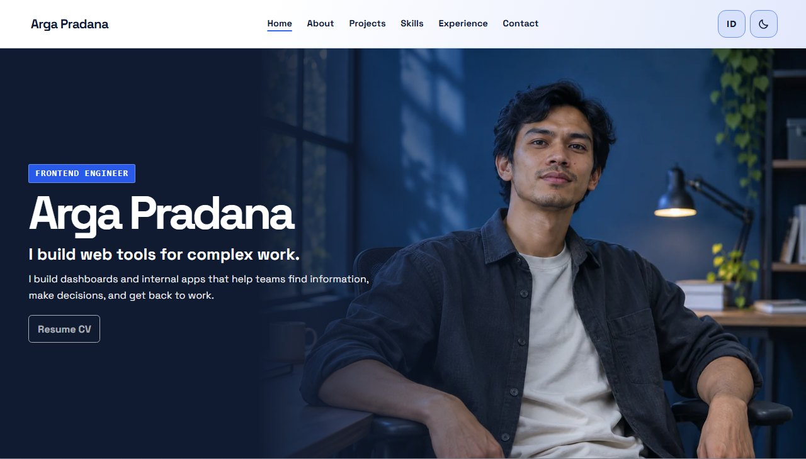
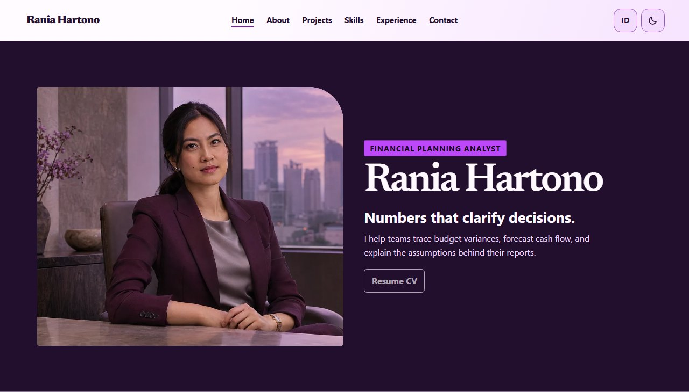

# TAP.ID Portfolio Templates

Six responsive Astro templates for TAP.ID’s NFC + Linktree + portfolio package. Each supports Indonesian and English, light and dark modes, and a single file for client content.

[Open the live portfolio gallery](https://horizonmirza.github.io/TAPID-Portfolio-Template/)

## Portfolio templates

| [Technology](Portfolio%201%20-%20Teknologi/README.md) | [Insurance](Portfolio%202%20-%20Asuransi/README.md) |
| --- | --- |
| [](Portfolio%201%20-%20Teknologi/README.md) | [](Portfolio%202%20-%20Asuransi/README.md) |

| [Management](Portfolio%203%20-%20Management/README.md) | [Visual Communication Design](Portfolio%204%20-%20DKV/README.md) |
| --- | --- |
| [](Portfolio%203%20-%20Management/README.md) | [](Portfolio%204%20-%20DKV/README.md) |

| [General](Portfolio%205%20-%20General/README.md) | [Finance](Portfolio%206%20-%20Finance/README.md) |
| --- | --- |
| [](Portfolio%205%20-%20General/README.md) | [](Portfolio%206%20-%20Finance/README.md) |

## Quick start

Use Node.js 24 LTS. This example runs the Technology template.

```sh
git clone https://github.com/HorizonMirza/TAPID-Portfolio-Template.git
cd "TAPID-Portfolio-Template/Portfolio 1 - Teknologi/Frontend"
npm ci
npm run dev
```

Open the address printed by Astro. The Indonesian site is at `/` and the English site is at `/en/`. From the same folder, run `npm run check` to validate the project and `npm run build` to generate `dist/`.

## Client setup

1. Copy the chosen theme and edit `Frontend/src/portfolio.json` with the public content approved by the client. Set `settings.demo` to `false`.
2. Deploy with the **Astro** preset in Vercel. Set **Root Directory** to the theme’s `Frontend` folder and **Output Directory** to `dist`.
3. Set `TAPID_SITE_URL` to the public HTTPS URL if the client uses a preferred domain. Vercel's production URL is used by default when system environment variables are enabled.
4. Check both languages, the custom 404 page, and all public contact links. Add the published site to the client’s Linktree.

Each template links to its setup guide, data reference, and build instructions.

## Publishing the public gallery

GitHub Actions checks and builds all six portfolios on pushes to `main`, then publishes the verified output to GitHub Pages. Pull requests run the same checks and build.

The public demos use temporary contact and résumé links from each template's `Frontend/src/demo-contact.ts`. Client builds use the links in `portfolio.json`.

### Verify a gallery release

From the repository root, use Node.js 24 and Python 3. Use a fresh output directory.

```sh
python3 .github/pages/build.py _site
```

The script installs dependencies from the lockfiles, checks and builds each Astro template, builds the gallery and its custom 404 from `.github/pages/src/pages/`, and validates links in the combined GitHub Pages artifact.

After publishing, open the [Pages workflow runs](https://github.com/HorizonMirza/TAPID-Portfolio-Template/actions/workflows/portfolio-pages.yml) and match the run's commit SHA to the release commit. Confirm the build and deploy jobs succeeded. Open the gallery, each theme's Indonesian and English pages, and a nonexistent URL under a theme. Check that the portfolio assets and section links work and that the nonexistent URL returns HTTP 404.

### Recover a gallery release

1. Identify the commit that introduced the problem using the workflow run and Git history.
2. With a clean working tree on an up-to-date `main`, run `git revert <bad-commit>` to create a recovery commit. If several dependent commits caused the problem, revert those commits from newest to oldest.
3. Build and verify the recovery commit using the steps above. Push to `main` and confirm its workflow deploys successfully. Repeat the public checks on the affected pages.

Periodically check the latest Pages deployment and run `npm audit --audit-level=moderate` in each theme's `Frontend` folder. Open the public résumé and contact destinations to confirm they still point to the intended accounts and that the résumé can be viewed while signed out.

## Assets

Demo profiles and content are fictional. The demo portraits were created with ImageGen. Font licenses are in `Frontend/public/fonts/OFL.txt`.

Footer logo sources are [WhatsApp](https://www.meta.com/en-gb/brand/resources/whatsapp/whatsapp-brand/), [Instagram](https://www.meta.com/en-gb/brand/resources/instagram/instagram-brand/), [LinkedIn](https://brand.linkedin.com/in-logo), [GitHub](https://brand.github.com/foundations/logo), [Google Drive](https://developers.google.com/workspace/drive/api/guides/branding#use_google_drive_logo), and [Linktree](https://linktr.ee/).
