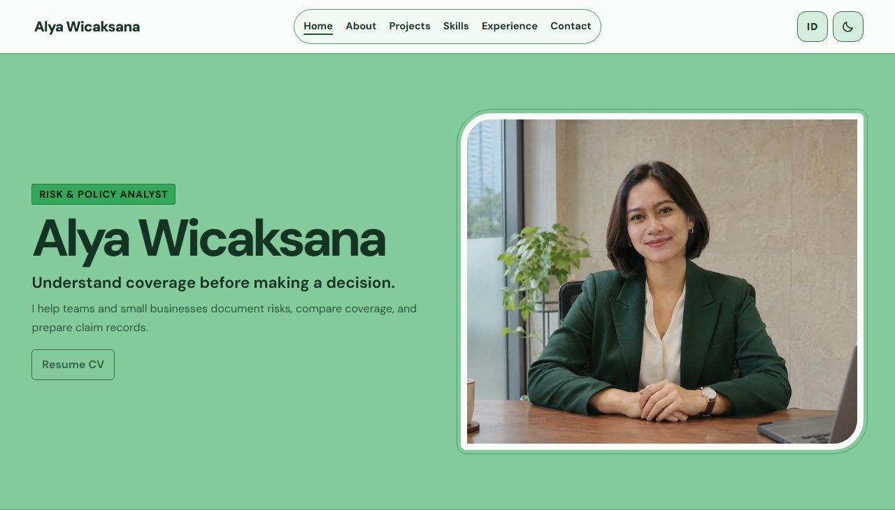
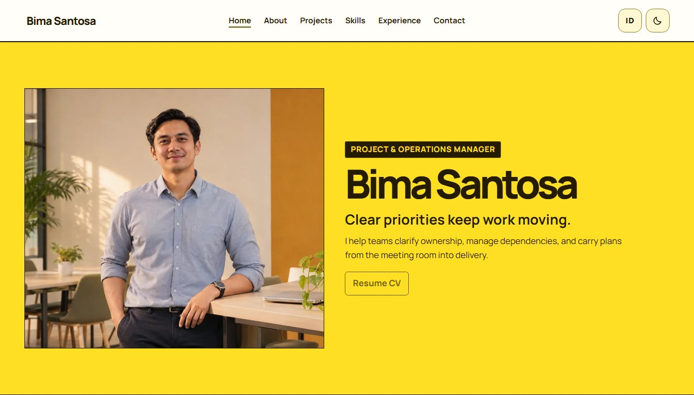
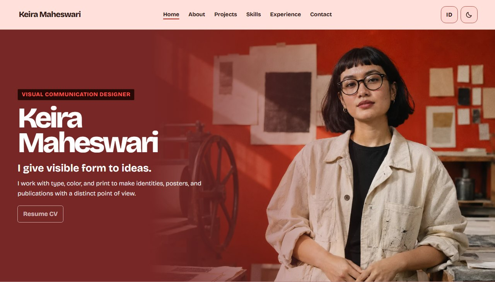
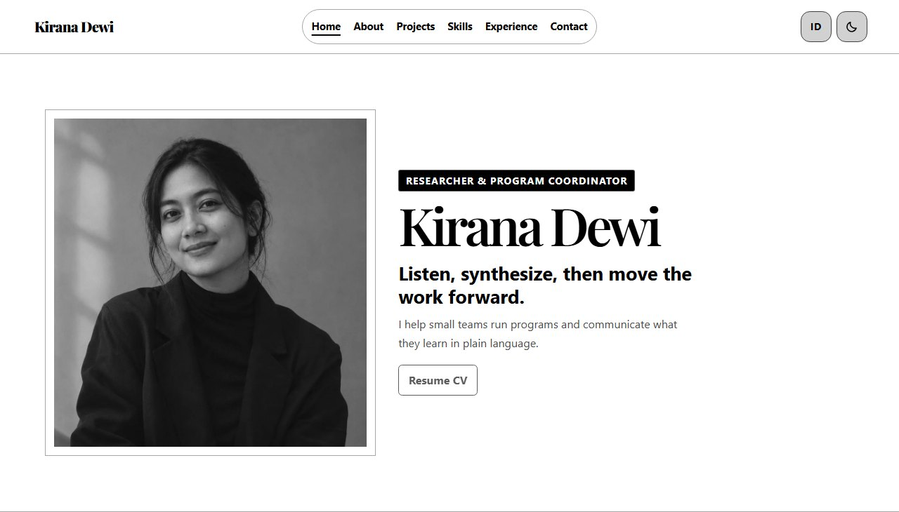

# TAP.ID Portfolio Templates

Six Portfolio Templates for TAP.ID.

## Portfolio Templates

| [Technology](Portfolio%201%20-%20Computer%20Science/README.md) | [Insurance](Portfolio%202%20-%20Insurence/README.md) |
| --- | --- |
|  |  |

| [Management](Portfolio%203%20-%20Management/README.md) | [Visual Communication Design](Portfolio%204%20-%20Visual%20Design/README.md) |
| --- | --- |
|  |  |

| [Finance](Portfolio%205%20-%20Finance/README.md) | [General](Portfolio%206%20-%20General/README.md) |
| --- | --- |
|  |  |

## Client Setup

1. Copy the chosen theme and edit `Frontend/src/portfolio.json` with the public content approved by the client. Set `settings.demo` to `false`.
2. Deploy with the **Astro** preset in Vercel. Set **Root Directory** to the theme’s `Frontend` folder and **Output Directory** to `dist`.
3. Set `TAPID_SITE_URL` to the public HTTPS URL if the client uses a preferred domain. Vercel's production URL is used by default when system environment variables are enabled.
4. Check both languages, the custom 404 page, and all public contact links. Add the published site to the client’s Linktree.

Each template links to its setup guide, data reference, and build instructions.
